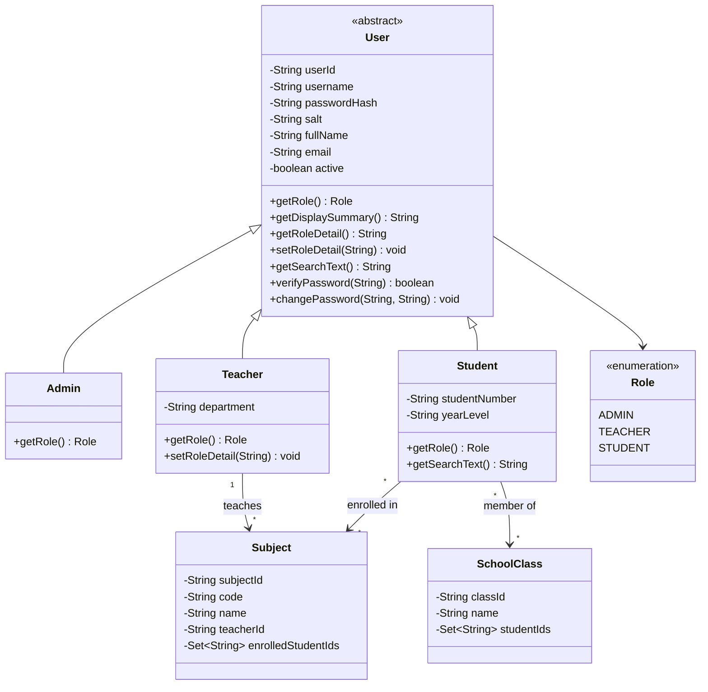
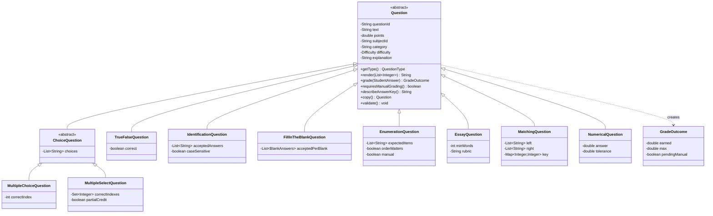
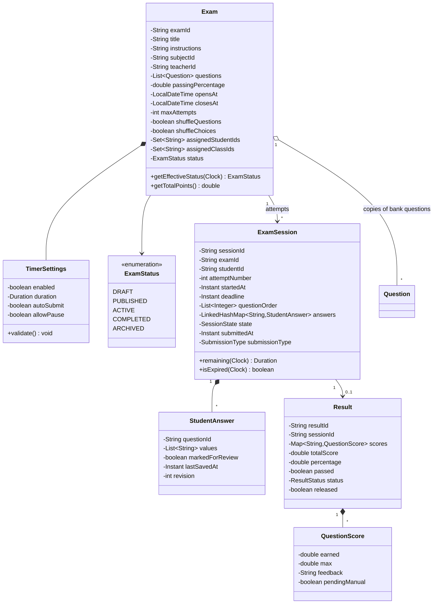
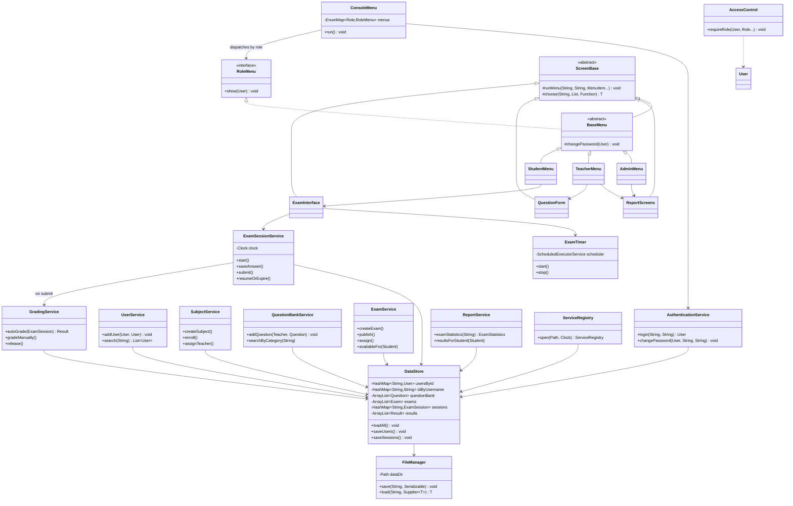

# UML Class Diagram

The diagrams below use Mermaid and display directly on GitHub. Fields and methods are trimmed to the important ones; see `docs/DESIGN.md` for full details. Classes marked `<<abstract>>` declare abstract methods (for example `Question.grade`, `User.getRole`) that each subclass overrides.

## 1. Users

## 2. Questions (abstraction and polymorphism)

## 3. Exams, sessions and results

## 4. Services, data and UI

